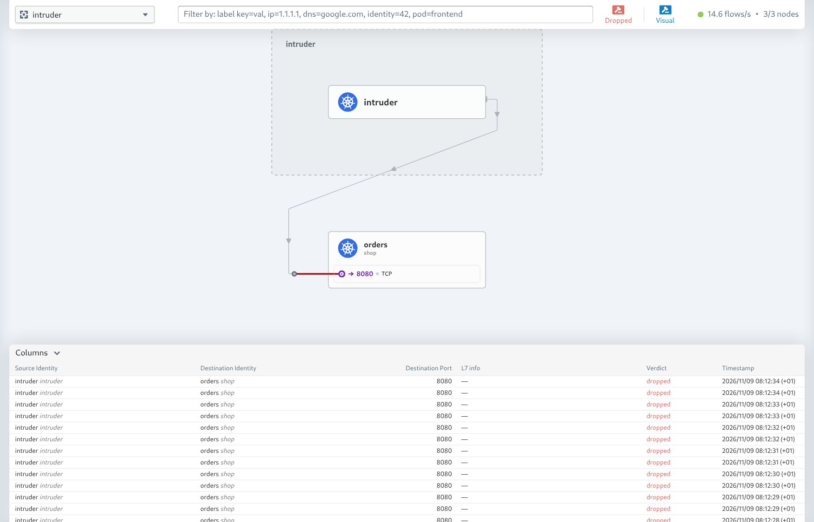

# Architektura i kontrakty

Ten dokument to wspólny kontrakt dla zadań T01–T36. Zmiana kontraktu wymaga PR, który aktualizuje ten plik i opis zadań, których dotyczy.

## Komponenty i wersje

| Komponent | Wersja | Namespace | Zadanie |
|---|---|---|---|
| kind, obraz węzła `kindest/node:v1.36.4@sha256:099e049362a1526b2db71494e1947aae99bd16290d7c895f2b7ea312e3cbfaed` (`KIND_NODE_IMAGE` w `platform/versions.env`) | 0.33.0 | — | T03, T04 |
| Cilium + Hubble (relay, UI, metryki) | 1.20.3 | kube-system | T03 |
| prometheus-operator-crds | przypięta w `platform/versions.env` | — | T03 |
| kube-prometheus-stack (Prometheus, Alertmanager, Grafana) | przypięta w `versions.env` | monitoring | T16 |
| Loki (chart z `grafana-community/helm-charts`, SingleBinary) | przypięta w `versions.env` | monitoring | T17 |
| Grafana Alloy | przypięta w `versions.env` | monitoring | T17 |
| Mailpit (`docker.io/axllent/mailpit`) | v1.33.0, przypięta po digest w `deploy/observability/mailpit/deployment.yaml` | monitoring | T19 |
| frontend, orders (Python 3.13, FastAPI) | — | shop | T05 |
| locust (`docker.io/locustio/locust`) | 2.47.0, przypięta po digest w `deploy/base/locust/deployment.yaml` | loadgen | T18 |
| fault-runner | — | loadgen | T08 |
| anomaly-detector (scikit-learn) | — | aiops | T24 |
| intruder (`docker.io/curlimages/curl`) | 8.23.0, przypięta po digest w `deploy/base/intruder/deployment.yaml` | intruder | T12 |

Narzędzia CLI w `mise.toml` (T02): Python 3.13.16, kind 0.33.0, kubectl 1.37.1, helm 4.3.1, kustomize 5.8.3, cilium-cli 0.20.1, hubble 1.20.2 (`github:cilium/hubble`), trivy 0.76.0, gitleaks 8.30.1, kubeconform 0.8.0, promtool 3.15.0, uv 0.13.7, ruff 0.17.3 (T06), yq 4.54.1 (T19); opentofu 1.13.1 dla rozszerzenia T33.

Wersje oznaczone „przypięta” wybiera się w dniu realizacji zadania (najnowsza stabilna) i wpisuje do `platform/versions.env`, gdy czyta je Makefile; obraz zewnętrzny używany tylko w manifeście z `deploy/` (intruder, locust) przypina się tagiem i digestem w tym manifeście. Trivy nigdy w wersji 0.69.4 (złośliwe wydanie, CVE-2026-33634). Charty Helm z rejestrów OCI przypina się wersją i digestem manifestu (`*_CHART_DIGEST` w `platform/versions.env`): `make cluster` instaluje `<chart>@<digest>` z `--version`, a Helm przerywa instalację, gdy tag wersji wskazuje inny digest.

Kubernetes 1.36 zamiast 1.37 to świadomy downgrade o jedną wersję (T03). kind 0.33.0 domyślnie stawia Kubernetes 1.37.0, ale Cilium 1.20 deklaruje testy e2e tylko dla Kubernetes 1.33–1.36 ([wymagania Cilium 1.20](https://docs.cilium.io/en/v1.20/network/kubernetes/requirements/)), więc węzły używają obrazu `kindest/node:v1.36.4`, zbudowanego dla kind 0.33.0. kubectl 1.37.1 z `mise.toml` zostaje, bo odchylenie o jedną wersję jest dozwolone. Na 1.37 przechodzimy, gdy przypięta wersja Cilium obejmie ją testami.

Obrazy dostawców w przypiętych wersjach (Cilium 1.20.3 z Envoy i Hubble UI, `kindest/node:v1.36.4`) mają znane podatności HIGH i CRITICAL bez nowszego wydania upstream (Trivy 0.76.0, 21.10.2026). To zaakceptowane ryzyko szczątkowe R5 ([model zagrożeń](bezpieczenstwo.md#ryzyka-szczątkowe), T07): klaster kind słucha tylko na `127.0.0.1`, a bramka Trivy w CI (T15) obejmuje obrazy budowane w projekcie. Piny podbijamy, gdy wyjdzie Cilium 1.20.4 albo nowszy obraz `kindest/node` 1.36.

`locustio/locust:2.47.0` (T18) też należy do R5: Trivy 0.76.0 (11.11.2026, `--ignore-unfixed`) zgłasza 2 CRITICAL i 9 HIGH w pakietach Debiana i Pythona (m.in. brotli, certifi, msgpack, urllib3). Poprawki istnieją w pakietach, ale nie ma jeszcze stabilnego wydania Locusta, które by je zawierało (2.46.7 ma ich więcej, a obrazy `2.47.1.devN` są przedpremierowe). Pod locust nie przyjmuje połączeń (default-deny, bez polityki ingress) i łączy się tylko z frontendem. Pin podbijamy przy następnym stabilnym wydaniu Locusta.

## Obrazy

Obrazy budowane w projekcie nazywają się `ghcr.io/l3x1cn/secure-k8s-aiops/<nazwa>` (`IMAGE_REPO` w `Makefile`) i powstają z korzenia repozytorium (workspace uv): `docker build -f <Dockerfile> .`. Manifesty w `deploy/base` podają obraz bez tagu, a tag ustawia overlay.

| Obraz | Dockerfile | Zadanie |
|---|---|---|
| frontend | `services/frontend/Dockerfile` | T05 |
| orders | `services/orders/Dockerfile` | T05, T08 |
| fault-runner | `chaos/Dockerfile` | T08 |

- Lokalnie `make images` buduje tag `:dev` i ładuje go do węzłów kind (overlay `local`).
- CI, workflow Images (`.github/workflows/images.yml`, T10, T15):
  - PR: job `build` buduje każdy obraz bez publikacji tokenem tylko do odczytu, ładuje go do Dockera runnera i skanuje bramką Trivy (niżej). Zbiorczy job `images` jest wymaganą kontrolą rulesetu `main` i jest zielony tylko wtedy, gdy wszystkie obrazy zbudowały się i przeszły bramkę;
  - push na `main`: job `push`, jedyny z `packages: write`, buduje obraz, skanuje go tą samą bramką, a dopiero po zielonej bramce loguje się do GHCR i publikuje tag `sha-<7 znaków SHA commita>`. Tagu `latest` nie ma;
  - komplet obrazów commita istnieje, gdy wszystkie joby `push` jego przebiegu są zielone. Overlay `cloud` (T29) przypina `sha-<7 znaków>@sha256:<digest>` z przebiegu `main`, więc digest przechodzi review, jak digesty chartów Helm;
  - etykiety OCI nadaje `docker/metadata-action`, m.in. `org.opencontainers.image.source` (adres repozytorium) i `org.opencontainers.image.revision` (pełny SHA commita).
- Bramka Trivy (T15): `scripts/trivy.sh` uruchamia Trivy 0.76.0 z `mise.toml` (bez `aquasecurity/trivy-action`). Obraz skanuje się z `--ignore-unfixed`, więc blokuje podatność HIGH albo CRITICAL z dostępną poprawką. Lokalnie: `bash scripts/trivy.sh image <nazwa> <obraz>`.
  - Wyniki ze wszystkimi poziomami (JSON i SARIF) trafiają do artefaktu `trivy-image-<nazwa>` (`reports/trivy/`, retencja 90 dni, raport testów T31), także po czerwonej bramce.
  - Job `sarif`, jedyny z `security-events: write`, wysyła SARIF do GitHub code scanning (kategoria `trivy-image-<nazwa>`). Nie uruchamia kodu z repozytorium i nie należy do rulesetu.
  - Końcowy etap każdego Dockerfile'a robi `apt-get upgrade` (poprawki z `trixie-security`, których obraz bazowy jeszcze nie ma) i usuwa pip: runtime go nie potrzebuje, a pakiety dołączone do pip (`pip/_vendor`) mają podatności HIGH i CRITICAL. Wersje pakietów Debiana zależą więc od dnia budowy, a digest obrazu bazowego zostaje przypięty.
  - Wyjątek wolno dodać tylko w `.trivyignore`: komentarz z uzasadnieniem nad wpisem i datą przeglądu `exp:RRRR-MM-DD`. `scripts/trivy.sh` przerywa skan, gdy wpis tego nie ma, a po tej dacie Trivy przestaje stosować wpis.
- Manifesty: wymagany job `manifests` w `ci.yml` uruchamia też `make trivy-config` (`trivy config deploy/`, HIGH i CRITICAL blokują; ta sama reguła `.trivyignore`). Wynik trafia do artefaktu `trivy-config`, a job `sarif` w `ci.yml` wysyła go do code scanning (kategoria `trivy-config`).
- Pakiety w GHCR są publiczne, więc obraz pobiera się bez logowania. Pierwsza publikacja nowego obrazu tworzy pakiet prywatny, a API GitHuba nie zmienia widoczności. Właściciel repozytorium przełącza więc pakiet ręcznie w UI (Package settings → Danger Zone → Change visibility → Public). Tej zmiany nie da się cofnąć.
- Ryzyko szczątkowe R6 ([model zagrożeń](bezpieczenstwo.md#ryzyka-szczątkowe), T07): tag `sha-<7 znaków>` jest mutowalny i niepodpisany, a pakiet połączony z repozytorium dziedziczy jego uprawnienia. Publikację tylko z `main` wymusza więc wyłącznie workflow, nie rejestr: współpracownik z uprawnieniem zapisu albo skradziony PAT może nadpisać tag obrazem z backdoorem bez review. Atestacja provenance (BuildKit) nie jest podpisana i nikt jej nie weryfikuje przy wdrożeniu. Dlatego wdrożenie ma używać digestu, nie samego tagu; podpisaną atestację (`actions/attest-build-provenance` z weryfikacją `gh attestation verify`) rozważymy, gdy deploy z GHCR stanie się realny (T29).
- Nowy obraz (np. anomaly-detector w T24) dopisuje się w pięciu miejscach: matrixy jobów `build`, `push` i `sarif` w `images.yml`, cel `images` w `Makefile`, lista `images:` (`newTag: dev`) w `deploy/overlays/local/kustomization.yaml` i tabela powyżej. Końcowy etap jego Dockerfile'a ma `apt-get upgrade` i usunięcie pip jak w `services/frontend/Dockerfile`, bo bez nich obraz nie przejdzie bramki. Ruleset się nie zmienia.

## Namespace'y i Pod Security

| Namespace | Zawartość | PSA (`enforce`, `warn`, `audit`) |
|---|---|---|
| shop | frontend, orders | restricted |
| loadgen | locust, fault-runner | restricted |
| aiops | anomaly-detector | restricted |
| intruder | intruder | restricted |
| monitoring | kube-prometheus-stack, Loki, Alloy, Mailpit | privileged; wyjątek: node-exporter i Alloy potrzebują dostępu do hosta |
| kube-system | Cilium, Hubble, CoreDNS | bez zmian |

Namespace'y opisuje `deploy/base/namespaces.yaml` (T04, T13); `make up` stosuje go przed sekretami i chartami. Każdy namespace z tabeli poza kube-system ma trzy etykiety `pod-security.kubernetes.io/<tryb>` z poziomem z tabeli:
- `enforce` odrzuca pod, który łamie poziom;
- `warn` dodaje ostrzeżenie `would violate PodSecurity` do odpowiedzi na `kubectl apply` Deploymentu, którego szablon poda łamie poziom. `enforce` sprawdza tylko pody, więc taki Deployment powstaje, a odrzucone pody widać dopiero w zdarzeniach ReplicaSetu;
- `audit` dopisuje naruszenie do zdarzenia w logu audytu serwera API; kind nie ma logu audytu.

Bez etykiety PSA bierze `warn` z `enforce`, a `audit` z konfiguracji serwera API (w kind privileged). Jawne etykiety dają te same poziomy w każdym klastrze, także w overlayu cloud (T29).

PSA działa na cały namespace, więc w monitoring każdy pod może być uprzywilejowany. Wymagają tego node-exporter (T16: `hostNetwork`, `hostPID`, hostPath `/`, `/proc` i `/sys`) i Alloy (T17: logi z węzła), a zabrania już poziom baseline. `warn` i `audit` mają tam też privileged, bo ostrzeżenia o zamierzonych wyjątkach przy każdym `make up` byłyby szumem. Pody w monitoring tworzą tylko charty z `make up` i ich operatory oraz Mailpit z `make deploy` (T19); zespół ma w RBAC tylko odczyt (T11).

Kontenery własnych workloadów (tabela w sekcji „RBAC”) mają securityContext (T13) według wzoru `deploy/base/frontend/deployment.yaml`:
- pod: `runAsNonRoot: true`, `runAsUser` i `runAsGroup` 10001, `seccompProfile.type: RuntimeDefault`;
- kontener: `allowPrivilegeEscalation: false`, `readOnlyRootFilesystem: true`, `capabilities.drop: [ALL]` bez `add`;
- jedyny zapisywalny katalog to `/tmp` z wolumenu `emptyDir` z `sizeLimit: 16Mi` (Mailpit: 64Mi na bazę SQLite z najwyżej 1000 wiadomości).

Obrazy budowane w projekcie mają `USER 10001:10001`. Obraz zewnętrzny, który działa z dowolnym UID, też dostaje 10001 (intruder: obraz curl ma użytkownika `curl_user`, uid 100). Obraz zewnętrzny, który z UID 10001 nie działa, dostaje swój domyślny UID bez roota, wpisany liczbą: kubelet nie uruchomi kontenera z `runAsNonRoot: true`, gdy obraz podaje użytkownika nazwą. PSA restricted nie wymaga `readOnlyRootFilesystem`, UID 10001 ani `/tmp`; pilnuje ich test.

Test: `tests/security/test_pod_security.py` (marker `security`); na działającym klastrze `uv run --locked pytest tests/security/test_pod_security.py`. Sprawdza:
- `kubectl apply --dry-run=server` poda z `privileged: true` w shop, loadgen, aiops i intruder kończy się błędem `violates PodSecurity "restricted:latest"`;
- każdy kontener podów z etykietą `app.kubernetes.io/part-of=secure-k8s-aiops` (poza usuwanymi) ma `runAsNonRoot: true`, `readOnlyRootFilesystem: true`, `allowPrivilegeEscalation: false`, `capabilities.drop: [ALL]` bez `add`, `seccompProfile.type: RuntimeDefault` i `/tmp` z wolumenu `emptyDir`. Kontener z obrazem projektu ma też `runAsUser` 10001.

Nowy workload z tą etykietą test obejmuje bez zmian w kodzie testu. `runAsGroup`, UID obrazów zewnętrznych, `sizeLimit` i brak innych zapisywalnych montowań sprawdza tylko review.

## RBAC

Żaden własny pod (workloady z tabeli poniżej) nie rozmawia z API klastra, a członkowie zespołu dostają tylko odczyt (T11). Zakaz nie obejmuje komponentów platformy z kube-system (Cilium, Hubble, CoreDNS) ani chartów z T16 i T17: mają własne konta i RBAC. Klaster nie odrzuca poda z tokenem API, więc złamanie zakazu wykrywa dopiero `tests/security/test_rbac.py` na działającym klastrze. Manifesty są w `deploy/base/rbac/`; `make deploy` stosuje je razem z aplikacjami.

Każdy własny workload działa na własnym ServiceAccount o swojej nazwie, z `automountServiceAccountToken: false` i bez Role ani bindingów. Deployment podaje `serviceAccountName: <nazwa>` i powtarza `automountServiceAccountToken: false` w specyfikacji poda, bo ustawienie poda ma pierwszeństwo przed ustawieniem konta. W żadnym własnym podzie nie ma więc katalogu `/var/run/secrets/kubernetes.io/serviceaccount`.

| ServiceAccount | Namespace | Workload z zadania |
|---|---|---|
| frontend | shop | T05 |
| orders | shop | T05 |
| locust | loadgen | T18 |
| fault-runner | loadgen | T08 |
| anomaly-detector | aiops | T24 |
| intruder | intruder | T12 |
| mailpit | monitoring | T19 |

Nowy workload dopisuje konto w trzech miejscach: `deploy/base/rbac/serviceaccounts.yaml`, `SERVICE_ACCOUNTS` w `tests/security/test_rbac.py` i tabela powyżej.

Ludzie dostają uprawnienia przez grupy. W kind nie ma kont osób, więc test sprawdza grupy impersonacją (`kubectl --as=<użytkownik> --as-group=<grupa>`).

| Grupa | Rola | Zakres | Uprawnienia |
|---|---|---|---|
| `team:developers` | Role `developer` (kopia w każdym namespace) | shop, loadgen, aiops | get, list, watch na pods, pods/log, services, deployments, configmaps i events (core i `events.k8s.io`); bez secrets, pods/exec i zapisu |
| `team:sre` | ClusterRole `sre-readonly` | cały klaster | get, list, watch na wszystkich zasobach poza secrets; z podzasobów tylko pods/log, bez exec, attach, port-forward i proxy |

RBAC nie ma reguł odmowy, więc `sre-readonly` wylicza zasoby po grupach API: zasoby GA Kubernetes 1.36 oraz CRD z Cilium (`cilium.io`) i prometheus-operator (`monitoring.coreos.com`). Bez `resources: ["*"]`: Trivy (KSV-0046, CRITICAL) odrzuca taką ClusterRole, a `trivy config` blokuje `deploy/` (T13, T15). Bez `nodes/proxy`: `get` na nim pozwala wykonać polecenie w dowolnym podzie przez API kubeletu. Zadanie, które dodaje zasób z nowej grupy API albo nowe CRD (np. chart w T16–T19), dopisuje go do `deploy/base/rbac/sre-readonly.yaml`; brakujące zasoby wypisuje test `test_sre_reads_every_listable_resource_except_secrets`.

Test: `tests/security/test_rbac.py` (marker `security`); na działającym klastrze `uv run --locked pytest tests/security/test_rbac.py`.

## Dostęp z hosta

Klaster kind `secure-k8s-aiops` (kontekst kubectl `kind-secure-k8s-aiops`) tworzy `make cluster` (T03). Całą platformę stawia `make up`, a usuwa `make down` (T04); `make urls` wypisuje adresy z tabeli.

Nie ma kontrolera Ingress (Ingress NGINX wycofano w marcu 2026); w demo wystarcza NodePort. Mapowania `extraPortMappings` w kind nasłuchują tylko na `127.0.0.1`.

| Adres | Usługa | Mechanizm |
|---|---|---|
| http://localhost:8080 | frontend | NodePort 30080 |
| http://localhost:3000 | Grafana | NodePort 30300 |
| http://localhost:8025 | Mailpit UI | NodePort 30825 |
| `make hubble-ui`, `make hubble-relay`, `make prometheus`, `make alertmanager` | Hubble UI (localhost:12000), Hubble CLI (relay, localhost:4245), Prometheus (localhost:9090), Alertmanager (localhost:9093) | port-forward |

`make prometheus` i `make alertmanager` łączą się z usługami `prometheus-operated` i `alertmanager-operated` w monitoring, które prometheus-operator (T16) tworzy niezależnie od nazwy release'u.

## Przepływy sieciowe

Wszystkie kontenery aplikacyjne słuchają na porcie 8080 (HTTP, `/metrics`, `/healthz`). W namespace'ach shop, loadgen i aiops obowiązuje default-deny dla ruchu przychodzącego i wychodzącego. Dozwolone są tylko te przepływy:

| Źródło | Cel | Port | Po co |
|---|---|---|---|
| dowolne | shop/frontend | 8080 | publiczna usługa (NodePort, Locust, fault-runner, intruder) |
| shop/frontend | shop/orders | 8080 | API zamówień |
| loadgen/fault-runner | shop/orders | 8080 | wstrzykiwanie awarii (z tokenem) |
| loadgen/locust, loadgen/fault-runner | shop/frontend | 8080 | ruch i skok ruchu |
| monitoring/Prometheus | shop/*, aiops/* | 8080 | pobieranie `/metrics` |
| aiops/anomaly-detector | monitoring/Prometheus :9090, monitoring/Loki :3100 | — | cechy i kontekst zdarzeń |
| każdy pod w shop, loadgen, aiops | kube-system/kube-dns | 53 UDP/TCP | DNS |

Manifesty są w `deploy/base/networkpolicies/` (T12); każdy obiekt podaje swój namespace:
- `default-deny.yaml`: polityka `default-deny` w shop, loadgen i aiops (wszystkie pody, Ingress i Egress, bez reguł);
- `dns.yaml`: polityka `allow-dns` w tych samych namespace'ach (wszystkie pody → kube-dns, 53 UDP/TCP);
- `shop.yaml`, `loadgen.yaml`, `aiops.yaml`: reguły allow z tablicy, po jednej polityce na workload i kierunek (`<workload>-ingress`, `<workload>-egress`).

Polityki się sumują: pod przyjmuje i wysyła tylko ruch dopuszczony przez którąś z nich. Namespace intruder nie ma polityk: pod `intruder` (`curlimages/curl`, czeka na `kubectl exec`) gra atakującego z wnętrza klastra, a jego ruch do orders odrzuca polityka `orders-ingress`. Cilium wpuszcza do poda ruch z jego węzła niezależnie od polityk (`allow-localhost`), więc sondy kubeleta działają.

Reguły wskazują pody etykietami, a namespace'y etykietą `kubernetes.io/metadata.name`. Zmiana etykiety albo portu workloadu wymaga zmiany reguły:

| Etykieta poda | Namespace | Nadaje ją |
|---|---|---|
| `app.kubernetes.io/name`: `frontend`, `orders`, `fault-runner`, `locust`, `anomaly-detector` | shop, loadgen, aiops | Deploymenty (T05, T08, T18, T24) |
| `role: fault-runner` | loadgen | Deployment fault-runner (T08); jedyny klient `/faults/*` w orders |
| `app.kubernetes.io/name: prometheus` | monitoring | prometheus-operator (T16) |
| `app.kubernetes.io/name: loki` | monitoring | chart Loki (T17) |

Nowy workload w shop, loadgen albo aiops dopisuje wiersz w tablicy przepływów i reguły w `deploy/base/networkpolicies/`; bez nich ma tylko DNS.

Test: `tests/security/test_network_policies.py` (marker `security`). Sonda w podzie źródłowym trwa najwyżej 5 s; Cilium porzuca odrzucony pakiet bez odpowiedzi, więc odrzucenie to przekroczenie czasu. Test sprawdza:
- dozwolone: frontend → orders (`POST /order` frontendu), fault-runner → orders `/healthz`, fault-runner → frontend, locust → frontend, intruder → frontend;
- odrzucane: intruder → orders, orders → frontend, locust → orders, orders → internet, frontend → internet, fault-runner → internet, locust → internet (1.1.1.1:443; bez wyjścia klastra do internetu przypadki z internetem są pomijane);
- politykę default-deny w shop, loadgen i aiops;
- odrzucenie intruder → orders z powodem `POLICY_DENIED` w Hubble.

Ręcznie: `make hubble-relay`, w drugim terminalu `hubble observe --verdict DROPPED --from-namespace intruder`. Bufor Hubble ma 4095 przepływów na węzeł (w spokojnym klastrze kilkanaście minut), więc przepływ trzeba wywołać tuż przed odczytem. W Hubble UI (`make hubble-ui`) adres `http://localhost:12000/?namespace=intruder&verdicts=2` pokazuje tylko odrzucone przepływy:



Używamy wyłącznie `networking.k8s.io/v1` NetworkPolicy, żeby te same manifesty działały w chmurze (T29).

W kube-system NetworkPolicy `hubble-relay-ui-ingress` (T03, `platform/cilium/hubble-networkpolicy.yaml`, stosuje ją `make cluster`) dopuszcza do Hubble Relay tylko ruch z Hubble UI na porcie 4245, a do Hubble UI nie dopuszcza ruchu z podów. Dostęp z hosta zostaje przez port-forward (`make hubble-ui`, `make hubble-relay`). Nowy klient Hubble Relay w klastrze wymaga reguły w tej polityce. Agent i operator Cilium działają w sieci hosta, więc NetworkPolicy ich nie obejmuje: metryki na portach 9962, 9963 i 9965 są czytelne z każdego poda (ryzyko szczątkowe R4 w [modelu zagrożeń](bezpieczenstwo.md#ryzyka-szczątkowe), T07).

## Kontrakt metryk i logów

- **Aplikacje.** `http_requests_total{method,route,status}`, histogram `http_request_duration_seconds{method,route}` (kubełki z granicą 0.3 s, progiem HighLatency) i domyślne metryki procesu z `prometheus_client`. `route` to szablon trasy (`/orders/{order_id}`), dla nieznanych ścieżek `unmatched`. `method` to `GET`, `HEAD`, `POST`, `PUT`, `PATCH`, `DELETE`, `OPTIONS`, a każda inna metoda to `OTHER`. Żądania `/healthz` i `/metrics` nie trafiają do metryk ani logów żądań. ServiceMonitor nadaje etykiety `namespace` i `service`. Implementacja: pakiet `libs/observability` (T05).
- **Logi.** Jedna linia JSON na zdarzenie na stdout, pola: `ts`, `level` (`DEBUG`, `INFO`, `WARNING`, `ERROR`), `service`, `route`, `status`, `duration_ms`, `msg`. Pola spoza żądania (`route`, `status`, `duration_ms`) mają wartość `null`; wyjątek dodaje pole `exc` ze śladem stosu. Żądania z odpowiedzią 4xx mają `level` = `WARNING`, 5xx = `ERROR`.
- **Zbieranie (T16).** kube-prometheus-stack w monitoring (`make observability`, krok `make up`; wartości w `deploy/observability/values/kube-prometheus-stack.yaml`). Prometheus zbiera wszystkie ServiceMonitory, PodMonitory i PrometheusRule w klastrze (bez selektora release'u), także Cilium i Hubble z kube-system. Scrape co 15 s, retencja 3 dni (najwyżej 4 GB) na PVC 5 Gi, więc dane przeżywają restart poda. W kind kube-controller-manager, kube-scheduler, etcd i kube-proxy wystawiają metryki tylko na `127.0.0.1` węzła, więc chart ich nie monitoruje (bez celów stale `down` i fałszywych alertów). ServiceMonitory `frontend` i `orders` leżą obok Service (`deploy/base/<usługa>/servicemonitor.yaml`).
- **Reguły nagrywające (T16).** PrometheusRule `recording-rules` (`deploy/observability/recording-rules.yaml`), etykiety `namespace="shop"` i `service` ∈ {frontend, orders}, krok 30 s. To jedyne wejście dla alertów regułowych i cech ML. `service` dla metryk kontenera to nazwa kontenera aplikacji, dla sieci poda złączenie z `kube_pod_container_info`, dla Hubble `source_workload`/`destination_workload`. Reguły `http_*` mają serie od pierwszego obsłużonego żądania; bez ruchu `http_errors_ratio` i `http_latency_p95_seconds` mają wartość NaN. `policy_drops` bez odrzuceń ma 0. Nowe odrzucenie tworzy serię `hubble_drop_total` od wartości z pierwszego scrape'u, więc `rate` liczy dopiero kolejne odrzucenia:

| Reguła | Znaczenie |
|---|---|
| `service:cpu_usage_ratio_of_limit` | zużycie CPU / limit CPU |
| `service:memory_working_set_ratio_of_limit` | working set pamięci / limit pamięci |
| `service:network_rx_bytes:rate1m` | ruch przychodzący poda (B/s) |
| `service:network_tx_bytes:rate1m` | ruch wychodzący poda (B/s) |
| `service:http_requests:rate1m` | żądania na sekundę |
| `service:http_errors_ratio:rate1m` | udział odpowiedzi 5xx |
| `service:http_latency_p95_seconds:1m` | p95 czasu odpowiedzi |
| `service:restarts:increase5m` | przyrost restartów kontenera w 5 min |
| `service:policy_drops:rate1m` | odrzucenia `POLICY_DENIED`, w których usługa jest celem lub źródłem (Hubble) |

Test: `tests/observability/test_metrics.py` (marker `observability`); na działającym klastrze `uv run --locked pytest tests/observability/test_metrics.py`. Sprawdza `up` = 1 dla frontend i orders, obecność `hubble_flows_processed_total` i skończoną wartość każdej reguły z tabeli dla obu usług przy ruchu z `fault-runner spike`.

- **Detektor (T24).**

| Metryka | Typ | Znaczenie |
|---|---|---|
| `aiops_anomaly_score{service}` | gauge | wynik, większy = bardziej anomalny |
| `aiops_anomaly_threshold{service}` | gauge | aktualny próg |
| `aiops_anomaly{service}` | gauge | 1 = anomalia |
| `aiops_model_ready{service}` | gauge | 1 = model wytrenowany |
| `aiops_scoring_errors_total` | counter | błędy pobierania lub oceny |

## Alerty

| Alert | Detektor | Warunek | `for` | Etykiety |
|---|---|---|---|---|
| HighCPU | rules | `service:cpu_usage_ratio_of_limit > 0.8` | 2m | `detector=rules`, `severity=warning` |
| HighMemory | rules | `service:memory_working_set_ratio_of_limit > 0.85` | 2m | jw. |
| HighErrorRate | rules | `service:http_errors_ratio:rate1m > 0.05` | 2m | jw. |
| HighLatency | rules | `service:http_latency_p95_seconds:1m > 0.3` | 2m | jw. |
| PodRestarts | rules | `service:restarts:increase5m > 0` | 0m | jw. |
| PolicyDeniedConnections | rules (Hubble) | `service:policy_drops:rate1m > 0` | 1m | jw. |
| AnomalyDetected | ml | `aiops_anomaly == 1` | 1m | `detector=ml`, `severity=warning` |
| IncidentConfirmed | hybrid | `aiops_anomaly == 1` i aktywny alert `detector="rules"` dla tego samego `service` | 0m | `detector=hybrid`, `severity=critical` |

Alerty regułowe są w PrometheusRule `rules-baseline` (`deploy/observability/alert-rules.yaml`, T19, krok 30 s). Wejściem są tylko reguły `service:*`, więc każdy alert ma etykiety `namespace="shop"` i `service`, a adnotacje `summary` i `description` są po polsku. Bez ruchu HTTP reguły `http_errors_ratio` i `http_latency_p95` mają NaN, więc HighErrorRate i HighLatency nie wystrzelą. `make manifests` (job `manifests` w CI) sprawdza `spec` każdego PrometheusRule z wyniku `kustomize build` przez `promtool check rules`; `yq` wycina `spec` do osobnego pliku.

Odbiorca: Alertmanager → Mailpit (SMTP `mailpit.monitoring.svc:1025`). Konfiguracja Alertmanagera jest w wartościach chartu (`alertmanager.config` w `deploy/observability/values/kube-prometheus-stack.yaml`), więc zmienia ją `make observability`:
- `route`: odbiorca `mailpit`, `group_by: [alertname, service]`, `group_wait: 30s`, `group_interval: 5m` (z chartu), `repeat_interval: 4h`. Watchdog i InfoInhibitor z reguł chartu idą do odbiorcy `null`. Pozostałe alerty chartu (np. KubePodCrashLooping) też trafiają do Mailpit;
- `mailpit`: e-mail od `alertmanager@platforma.local` do `zespol@platforma.local`, `require_tls: false`. Temat ma postać `[FIRING:<liczba alertów>] <alertname> <service> (<wspólne etykiety>)`, np. `[FIRING:1] PolicyDeniedConnections orders (rules shop … warning)`; treść zawiera etykiety i adnotacje. E-maila o rozwiązaniu alertu nie ma (`send_resolved` domyślnie wyłączone dla e-maili);
- `inhibit_rules` i `global` zostają z chartu (Helm scala mapy, a listy zastępuje).

Mailpit (`deploy/observability/mailpit/`, stosuje go `make deploy`) przyjmuje pocztę na porcie 1025 i pokazuje ją w UI pod http://localhost:8025 (NodePort 30825). Trzyma najwyżej 1000 wiadomości w SQLite w `/tmp` (`emptyDir`), więc poczta znika z podem. Działa jako UID 10001, z tym samym securityContext co workloady w namespace'ach restricted, choć monitoring ma PSA privileged. Usługa `mailpit` (SMTP i HTTP) jest typu ClusterIP; UI wystawia osobna usługa `mailpit-ui` (tylko port HTTP), którą overlay `local` zmienia na NodePort 30825, tak jak frontend. Szukanie po API: `curl 'localhost:8025/api/v1/search?query=subject:PolicyDeniedConnections'`.

Czas od zdarzenia do e-maila to suma: scrape (15 s), okno `rate` (1 min), krok reguł nagrywających i alertów (30 s), `for` alertu i `group_wait` (30 s). Zmierzone na kind (T19): PolicyDeniedConnections (`for: 1m`) 110–130 s od pierwszej próby intruder → orders (2 pomiary), HighErrorRate (`for: 2m`) 196 s od startu S3, osobny e-mail dla frontend i orders.

## Sekrety

Sekrety tworzy `make secrets` (`scripts/secrets.sh`, krok `make up`): tylko brakujące, z `openssl rand -hex 32`, bez zapisu wartości na dysk i bez wypisywania; nigdy nie trafiają do git. `orders-api-token` i `fault-token` (ta sama wartość w shop i loadgen) skrypt tworzy od T04, `grafana-admin` (użytkownik `admin`, losowe hasło) od T16, bo bez niego Grafana nie wstaje. Hasło Grafany wypisuje na żądanie `make grafana-password` (T14). Pilnują tego (T14): `tests/security/test_secrets.py` (w plikach `deploy/` i w wyniku `kustomize build` overlayów nie ma Secretu z `data` ani `stringData`, a `make gitleaks` nie ma znalezisk w historii HEAD) oraz hook pre-commit z gitleaksem (`.pre-commit-config.yaml`), który lokalnie blokuje commit z sekretem.

| Secret | Namespace | Klucze | Użycie |
|---|---|---|---|
| `orders-api-token` | shop | `token` | frontend → orders (`Authorization: Bearer`); obie usługi czytają go ze zmiennej `ORDERS_API_TOKEN` |
| `fault-token` | shop, loadgen | `token` (ta sama wartość) | fault-runner → orders (`X-Fault-Token`); orders czyta go ze zmiennej `FAULT_TOKEN`, fault-runner z pliku `/var/run/secrets/fault-token/token` |
| `grafana-admin` | monitoring | `admin-user`, `admin-password` | logowanie do Grafany |

## Ruch (Locust)

Locust (T18) daje stały ruch do frontendu, na którym uczy się detektor (T20, T23). Deployment `locust` w loadgen (`deploy/base/locust/`) uruchamia Locusta w trybie headless, bez interfejsu WWW i bez portu. Host to `http://frontend.shop.svc:8080`, a `locustfile.py` trafia do ConfigMap przez `configMapGenerator`. Nazwa ConfigMap ma sufiks z hasza treści, więc zmiana pliku i `make deploy` restartują poda.

- **Użytkownicy:** `LoadTestShape` (`SineWithNoise`) wyznacza ich liczbę jako 10 + 8·sin(2πt / 30 min) plus szum gaussowski (σ = 1,5 użytkownika, losowany raz na minutę). Wynik jest zaokrąglany i obcinany do 2–18. Sinusoida zaczyna się od startu kontenera, a test nie kończy się sam.
- **Żądania:** każdy użytkownik w 70% iteracji wysyła `GET /`, a w 30% `POST /order` z losowym produktem z katalogu frontendu i ilością 1–3. Między iteracjami czeka 1–3 s, więc ruch to ok. 1–9 żądań/s.
- **Wyniki:** ruch widać w `service:http_requests:rate1m{service="frontend"}`. Logi Locusta (`kubectl -n loadgen logs deploy/locust`) pokazują tylko zmiany liczby użytkowników (`--only-summary`).

Test: `tests/observability/test_traffic.py` (marker `observability`). Do reguły `service:http_requests:rate1m{service="frontend"}` z ostatniej godziny (krok 30 s) dopasowuje sinusoidy o okresach 10–60 min. Najlepsza ma okres 30 ± 5 min, amplitudę co najmniej 0,3 średniej i R² co najmniej 0,5. Godzina ruchu musi upłynąć od startu kontenera locust plus 5 min rozgrzewki; wcześniej test jest pomijany. W tej godzinie nie może być skoku ruchu S6 (`fault-runner spike --users 50`): kilkadziesiąt żądań/s przez 3 min psuje dopasowanie i test nie przechodzi. Krótki ruch z `fault-runner spike --users 2` w `test_metrics.py` mu nie przeszkadza. Przepływy Locusta sprawdza `tests/security/test_network_policies.py`.

## Scenariusze awarii

Wszystkie endpointy `/faults/*` należą do `orders`, są aktywne tylko przy `FAULTS_ENABLED=true` (overlay `local`; w `base` jest `false`, a endpointy zwracają wtedy 404) i wymagają nagłówka `X-Fault-Token` (brak lub zły token: 403). `POST /faults/stop` kończy bieżącą awarię.

- Naraz działa jedna awaria; nowa zastępuje bieżącą. Awaria kończy się sama po `seconds` (domyślne wartości jak w tabeli, zakres 1–3600).
- Odpowiedź: 202 i `{"fault": "<nazwa>", "ends_at": "<czas UTC>"}`; `stop` zwraca 200 i `{"stopped": "<nazwa>"}` albo `null`.
- `errors` (`ratio` ∈ (0, 1]) i `latency` (`ms` ∈ [1, 10000]) działają na trasach `/orders`. Odsetek błędów jest deterministyczny: przy `ratio=0.5` co druga odpowiedź to 500.
- `memory` (`target_ratio` ∈ (0, 0.95]) zajmuje `target_ratio × memory.max − memory.current` z cgroup v2; bez limitu pamięci kontenera zwraca 409.
- `crash` kończy proces kodem 1 zaraz po wysłaniu odpowiedzi 202; powtórzenia S5 planuje orkiestrator (T21).
- Klient: `fault-runner fault <nazwa> [--seconds N] [--param k=v]`, `fault-runner stop`, `fault-runner spike --users N --seconds S` w podzie `loadgen/fault-runner` (`kubectl exec`).

| ID | Nazwa | Cel | Mechanizm | Czas | Oczekiwane alerty |
|---|---|---|---|---|---|
| S1 | cpu | orders | `POST /faults/cpu?seconds=120`: pętla obciążająca CPU | 2 min | HighCPU, AnomalyDetected |
| S2 | memory | orders | `POST /faults/memory?seconds=180&target_ratio=0.9`: alokacja do 90% limitu pamięci (odczyt z cgroup) | 3 min | HighMemory, AnomalyDetected |
| S3 | errors | orders | `POST /faults/errors?seconds=180&ratio=0.5`: 50% odpowiedzi 500 | 3 min | HighErrorRate, AnomalyDetected, IncidentConfirmed |
| S4 | latency | orders | `POST /faults/latency?seconds=180&ms=500` | 3 min | HighLatency, AnomalyDetected |
| S5 | crash | orders | `POST /faults/crash` 3 razy co 60 s | 3 min | PodRestarts, AnomalyDetected |
| S6 | spike | frontend | `fault-runner spike --users 50 --seconds 180` | 3 min | AnomalyDetected (reguły nie mają progu na skok ruchu) |
| S7 | scan | orders | intruder: `curl -m 1` na orders:8080 oraz porty 22, 80, 443, 5432 i 6379, co 1 s | 2 min | PolicyDeniedConnections, AnomalyDetected |

## Struktura repozytorium

```
.
├── .github/               # workflows/ci.yml: kontrole PR (T06), bramka Trivy dla deploy/ i job sarif (T15); workflows/images.yml: obrazy i GHCR (T10), bramka Trivy i job sarif (T15); dependabot.yml (T06)
├── .pre-commit-config.yaml # hook gitleaks przed commitem (T14)
├── .trivyignore           # wyjątki bramki Trivy: uzasadnienie i data przeglądu (T15)
├── mise.toml              # wersje narzędzi (T02)
├── Makefile               # doctor (T02); cluster, hubble-ui, hubble-relay (T03); up, down, namespaces, secrets, images, deploy, status, urls, prometheus, alertmanager (T04); lint, unit, gitleaks, manifests (T06); trivy-config (T15); observability (T16); grafana-password (T14); test, report (dalej)
├── pyproject.toml         # uv workspace, Python 3.13 (T02)
├── platform/              # kind, Cilium, versions.env (T03, T04)
├── deploy/
│   ├── base/              # namespace'y, aplikacje, RBAC, NetworkPolicy (T04, T11–T13)
│   ├── overlays/local/    # kind (T04)
│   ├── overlays/cloud/    # zarządzany Kubernetes (T29)
│   └── observability/     # values/ chartów Helm, reguły, dashboardy (T16–T19, T22); zasoby dołącza deploy/base
├── libs/
│   └── observability/     # wspólny kontrakt metryk i logów JSON dla usług (T05)
├── services/              # obrazy budowane z korzenia: docker build -f services/<nazwa>/Dockerfile .
│   ├── frontend/          # (T05)
│   └── orders/            # (T05, T08)
├── aiops/                 # pakiet aiops: cechy, model, detektor, ewaluacja (T20–T25, T30)
├── chaos/                 # fault-runner i run.py (T08, T21)
├── tests/                 # security/, observability/, e2e/ (T11–T14, T16, T18, T26, T27)
├── scripts/               # doctor.sh (T02), secrets.sh (T04, T14, T16), manifests.sh (T06), trivy.sh (T15) i skrypty pomocnicze
├── infra/                 # OpenTofu, rozszerzenie (T33)
├── reports/               # wyniki testów i przebiegów, poza git (T26–T31)
└── docs/                  # karta, architektura, bezpieczeństwo, detekcja, runbook, demo
```
