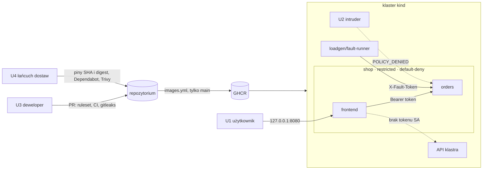

# Model zagrożeń i macierz kontroli

Dokument opisuje, przed czym broni się platforma, jakimi kontrolami i jakim testem automatycznym każdą z nich sprawdzamy (T07). Stan na 10.11.2026 (`main` po T13). Kolumna „Stan” mówi, czy test już działa w `main`, czy dopiero dojdzie w podanym zadaniu.

Zadanie, które dodaje zasób, przepływ sieciowy, sekret, obraz albo uprawnienie, aktualizuje macierz w tym samym PR. Zaakceptowane ryzyko dopisuje się do „Ryzyk szczątkowych” z uzasadnieniem i warunkiem powrotu do tematu.

## Zakres i założenia

- Platforma działa na klastrze kind na laptopie albo runnerze CI. Porty z hosta (`extraPortMappings`) słuchają tylko na `127.0.0.1`. Overlay `cloud` (T29) zmienia ten obraz; model trzeba wtedy przejrzeć.
- Repozytorium i pakiety w GHCR są publiczne.
- Dane są syntetyczne, bez danych osobowych.
- Poza zakresem: przejęcie systemu hosta, GitHuba albo rejestru GHCR jako usług oraz ataki fizyczne. DoS opisujemy tylko tam, gdzie zakłóca detekcję.

## Zasoby

| ID | Zasób | Gdzie | Co tracimy po przejęciu |
|---|---|---|---|
| A1 | Dane zamówień | pamięć procesu `orders` (shop) | poufność i integralność jedynych danych biznesowych |
| A2 | Tokeny: `orders-api-token`, `fault-token`, `grafana-admin` | Secrety w shop, loadgen, monitoring (sekcja „Sekrety” w [architekturze](architektura.md#sekrety)) | `orders-api-token` daje pełny dostęp do API zamówień; `fault-token` pozwala wywołać awarie (CPU, pamięć, crash) |
| A3 | API klastra | kube-apiserver | odczyt sekretów, `exec` w podach i tworzenie podów to pełna kontrola nad klastrem |
| A4 | Obrazy i łańcuch budowy | GHCR, Dockerfile, GitHub Actions, `uv.lock`, `mise.lock`, charty Helm | kod atakującego uruchomiony w każdym wdrożeniu |
| A5 | Sygnały detekcji | metryki, logi, alerty, model ML | atak niewidoczny albo zalew fałszywych alarmów |

## Aktorzy

| ID | Aktor | Punkt wejścia | Co może | W projekcie |
|---|---|---|---|---|
| U1 | Użytkownik zewnętrzny | frontend (`localhost:8080`, NodePort 30080; w chmurze LoadBalancer) | dowolne żądania HTTP do frontendu | Locust, `fault-runner spike` |
| U2 | Przejęty pod | kod wykonany w dowolnym podzie, np. przez lukę we frontendzie albo złośliwą zależność | połączenia sieciowe z wnętrza klastra, odczyt plików poda, skan portów | pod `intruder` w namespace intruder (scenariusz S7) |
| U3 | Nieuważny deweloper | commit i PR | sekret w commicie, osłabiony manifest (privileged, `resources: ["*"]`, usunięta polityka) | testowe PR #45 (fałszywy klucz AWS), #46 (błędny manifest), #50 (zepsuty Dockerfile) |
| U4 | Łańcuch dostaw | zależności PyPI, obrazy bazowe i dostawców, akcje GitHub, narzędzia CLI, charty | złośliwy kod w budowie albo w działającym podzie | kompromitacja `trivy-action` i Trivy 0.69.4 (CVE-2026-33634) |

Granice zaufania i miejsca, w których działają kontrole:

## Zagrożenia

| ID | Zagrożenie | Aktor | Zasób | Przykład |
|---|---|---|---|---|
| Z1 | Ruch boczny | U2 | A1, A2 | przejęty pod łączy się z orders albo skanuje porty usług (S7) |
| Z2 | Eksfiltracja | U2 | A1, A2 | przejęty frontend albo orders wysyła dane do internetu |
| Z3 | Eskalacja uprawnień | U2, U3 | A3 | token ServiceAccount w podzie użyty wobec API; kontener z rootem albo `privileged` jako droga na węzeł; zbyt szeroka rola zespołu |
| Z4 | Wyciek sekretu | U3, U2 | A2 | token w commicie publicznego repozytorium, w manifeście, w logu albo czytelny przez rolę zespołu |
| Z5 | Podatny lub złośliwy obraz | U4, U3 | A4 | obraz bazowy z CVE, przejęta akcja CI, nadpisany tag w GHCR |
| Z6 | Nadużycie endpointów awarii | U1, U2 | A1, A5 | wywołanie `/faults/crash` albo `/faults/memory` przez kogoś innego niż fault-runner |
| Z7 | Zakłócenie detekcji | U1 | A5 | losowe metody i ścieżki HTTP mnożą serie metryk; pamięć poda rośnie i daje fałszywą anomalię |

## Wymogi bezpieczeństwa MVP

Każdy z czterech wymogów z [karty projektu](karta-projektu.md#zakres-mvp) ma kontrolę i nazwany test automatyczny.

| Wymóg | Kontrola | Zadanie | Test automatyczny | Stan |
|---|---|---|---|---|
| W1 Ograniczenie uprawnień | konta usług bez tokenu API i bez bindingów; role zespołu tylko do odczytu, bez secrets i exec; PSA `restricted` i securityContext | T11, T13 | `tests/security/test_rbac.py::test_own_pods_have_no_service_account_token`, `::test_permission_matrix`, `::test_team_roles_are_read_only`; `tests/security/test_pod_security.py` | RBAC i test PSA działają |
| W2 Brak publicznych sekretów | sekrety tworzone przy wdrożeniu (`make secrets`); gitleaks na całej historii w CI; gitleaks w pre-commit | T04, T06, T14 | wymagany job CI `secrets` (`make gitleaks`; zablokował PR #45); `tests/security/test_secrets.py` | działa |
| W3 Skan obrazów | `trivy image --ignore-unfixed --severity CRITICAL,HIGH` przed publikacją; `trivy config deploy/` | T15 | kroki `trivy image` w `images.yml` i `trivy config` w `ci.yml`; testowy PR z `FROM python:3.8-slim` ma być zablokowany | T15 |
| W4 Test niedozwolonego połączenia | default-deny w shop, loadgen i aiops z jawną listą przepływów; odrzucenie widoczne w Hubble; alert `PolicyDeniedConnections` | T12, T19, T26 | `tests/security/test_network_policies.py::test_intruder_to_orders_is_denied`, `::test_hubble_shows_policy_denied_intruder_to_orders`; `tests/security/mutation_check.sh` | testy sieci działają; alert działa (T19: e-mail w Mailpit ok. 2 min po pierwszej próbie, test automatyczny w T27); test mutacyjny w T26 |

## Macierz: zagrożenie → kontrola → zadanie → test

| Zagrożenie | Kontrola | Zadanie | Test automatyczny | Stan |
|---|---|---|---|---|
| Z1 Ruch boczny | default-deny dla ruchu przychodzącego i wychodzącego, tylko przepływy z [tablicy](architektura.md#przepływy-sieciowe) | T12 | `tests/security/test_network_policies.py::test_namespace_has_default_deny`, `::test_intruder_to_orders_is_denied`, `::test_orders_to_frontend_is_denied`, `::test_allowed_flow` | działa |
| Z1 | test mutacyjny: bez `default-deny` w shop testy odmowy muszą zawieść | T26 | `tests/security/mutation_check.sh` | T26 |
| Z1 | orders wymaga `Authorization: Bearer`, porównanie w stałym czasie (`hmac.compare_digest`) | T05 | `services/orders/tests/test_app.py::test_orders_reject_requests_without_valid_token` | działa |
| Z1 | wykrycie: alert `PolicyDeniedConnections`, cecha ML `service:policy_drops:rate1m` | T19, T24 | `tests/e2e/test_alert_flow.py` (ruch intruder → e-mail w Mailpit) | T27 |
| Z2 Eksfiltracja | default-deny egress: pody w shop, loadgen i aiops nie łączą się z internetem | T12 | `tests/security/test_network_policies.py::test_egress_to_internet_is_denied` (pomijany bez wyjścia klastra do internetu) | działa |
| Z2 | wychodzący ruch poda jako cecha ML (`service:network_tx_bytes:rate1m`) | T16, T23 | ewaluacja detekcji | T30 |
| Z3 Eskalacja uprawnień | każdy własny workload na własnym ServiceAccount z `automountServiceAccountToken: false` i bez Role ani bindingów | T11 | `tests/security/test_rbac.py::test_service_account_does_not_automount_token`, `::test_own_pods_have_no_service_account_token`, `::test_service_accounts_have_no_rbac_bindings`, `::test_own_deployments_use_their_service_account` | działa |
| Z3 | role `developer` i `sre-readonly`: tylko get, list, watch; bez secrets, exec, attach, port-forward, proxy i `nodes/proxy` | T11 | `tests/security/test_rbac.py::test_permission_matrix`, `::test_team_roles_are_read_only`, `::test_sre_reads_every_listable_resource_except_secrets` | działa |
| Z3 | PSA `restricted` (`enforce`, `warn`, `audit`) w shop, loadgen, aiops i intruder | T04, T13 | `tests/security/test_pod_security.py::test_privileged_pod_is_rejected` (`kubectl apply --dry-run=server` uprzywilejowanego poda kończy się błędem) | działa |
| Z3 | securityContext: UID 10001, `readOnlyRootFilesystem`, `allowPrivilegeEscalation: false`, `drop: [ALL]`, `RuntimeDefault` | T05, T13 | `tests/security/test_pod_security.py::test_own_containers_are_hardened`; `trivy config deploy/` bez HIGH i CRITICAL | test działa; `trivy config` w CI w T15 |
| Z3 | ruleset `main`: PR z jedną recenzją, bez force-push i usuwania, wymagane kontrole `lint`, `unit`, `secrets`, `manifests`, `images` | T06, T10 | wymagane kontrole CI (zablokowały PR #45, #46 i #50) | działa |
| Z4 Wyciek sekretu | sekrety z `openssl rand -hex 32` tworzone przez `make secrets`, bez zapisu na dysk i wypisywania | T04, T14 | `tests/security/test_secrets.py::test_deploy_files_have_no_secret_values`, `::test_overlays_render_no_secret_values`: w plikach `deploy/` i w wyniku `kustomize build` nie ma `kind: Secret` z `data` ani `stringData` | działa |
| Z4 | gitleaks na całej historii osiągalnej z HEAD | T06, T14 | wymagany job CI `secrets` (`make gitleaks`); `tests/security/test_secrets.py::test_history_has_no_leaks` | działa |
| Z4 | gitleaks w pre-commit blokuje commit lokalnie | T14 | — (ręcznie: commit z fałszywym kluczem, kryterium T14) | działa |
| Z4 | role zespołu bez dostępu do secrets | T11 | `tests/security/test_rbac.py::test_permission_matrix` | działa |
| Z5 Podatny lub złośliwy obraz | bramka Trivy dla obrazów budowanych w projekcie, wyniki SARIF w code scanning | T15 | kroki `trivy image` w `images.yml` | T15 |
| Z5 | obrazy bazowe (`python:3.13.16-slim`, `uv`) i BuildKit przypięte po digeście; akcje przypięte po SHA (wymaga tego repozytorium); charty Helm po digeście; narzędzia z `mise.lock` z sumami kontrolnymi | T03, T06, T10 | wymagane kontrole `images` i `unit` (`uv run --locked`); Helm przerywa instalację przy innym digeście | działa |
| Z5 | Dependabot z 7-dniowym cooldownem dla akcji i `uv.lock` | T06 | — (PR Dependabota przechodzi te same wymagane kontrole) | działa |
| Z5 | publikacja tylko z `main`; `packages: write` ma wyłącznie job `push` | T10 | wymagana kontrola `images` | działa |
| Z6 Nadużycie awarii | `FAULTS_ENABLED=false` w `base`: `/faults/*` zwracają 404 | T08 | `services/orders/tests/test_faults.py::test_faults_are_404_when_disabled` | działa |
| Z6 | `X-Fault-Token` porównywany w stałym czasie; inny token niż do API zamówień | T08 | `services/orders/tests/test_faults.py::test_faults_reject_requests_without_valid_fault_token` | działa |
| Z6 | do orders łączy się z loadgen tylko pod z `role: fault-runner` | T12 | `tests/security/test_network_policies.py::test_allowed_flow` (fault-runner → orders), `::test_intruder_to_orders_is_denied` | działa |
| Z7 Zakłócenie detekcji | etykiety `method` i `route` z zamkniętego zbioru (`OTHER`, `unmatched`) | T05 | `libs/observability/tests/test_observability.py::test_unknown_methods_share_one_label`, `::test_unknown_paths_share_one_label` | działa |
| Z7 | magazyn orders ograniczony `MAX_ORDERS`, najstarsze zamówienia wypadają | T05 | `services/orders/tests/test_app.py::test_store_evicts_oldest_orders_over_limit` | działa |
| Z7 | alert krytyczny `IncidentConfirmed` tylko przy zgodzie reguł i ML | T25 | `tests/e2e/test_alert_flow.py` | T27 |

## Ryzyka szczątkowe

| # | Ryzyko | Dlaczego akceptujemy | Kiedy wracamy |
|---|---|---|---|
| R1 | Namespace monitoring nie ma default-deny i ma PSA `privileged`. | Charty z T16–T19 łączą się z wieloma celami w klastrze, a node-exporter i Alloy potrzebują dostępu do hosta. W monitoring nie ma własnego kodu projektu. | overlay `cloud` (T29) |
| R2 | node-exporter i Alloy działają z uprawnieniami do hosta. Ucieczka z ich kontenera daje węzeł. | Bez tego nie ma metryk węzła ani logów kontenerów. Wersje chartów są przypięte w `platform/versions.env`. node-exporter (T16): `hostNetwork`, `hostPID`, hostPath `/`, `/proc` i `/sys` tylko do odczytu, UID 65534, bez eskalacji uprawnień i bez capabilities (`deploy/observability/values/kube-prometheus-stack.yaml`). | T17: przegląd wartości chartu Alloy |
| R3 | kind to nie produkcja. Wszystkie węzły to kontenery Dockera na jednym hoście, więc dostęp do Dockera to root w klastrze. Każdy członek zespołu ma lokalnie kubeconfig administratora z kind; role zespołu sprawdzamy tylko impersonacją. Ruch między podami nie jest szyfrowany (Cilium bez transparent encryption), a API nie zapisuje logów audytu. | Platforma demonstracyjna na laptopie, porty tylko na `127.0.0.1`. | T29 |
| R4 | Agent i operator Cilium działają w sieci hosta, więc NetworkPolicy ich nie obejmuje. Metryki na portach 9962, 9963 i 9965 są czytelne z każdego poda. | Metryki ujawniają nazwy namespace'ów i workloadów oraz liczniki przepływów. Nie zawierają danych zamówień ani tokenów. Ograniczenie wymagałoby polityk hosta Cilium (CRD), a używamy tylko `networking.k8s.io/v1`. | T29 |
| R5 | Obrazy dostawców (Cilium 1.20.3 z Envoy i Hubble UI, `kindest/node:v1.36.4`) mają podatności HIGH i CRITICAL bez nowszego wydania upstream (Trivy 0.76.0, 21.10.2026). | Klaster słucha tylko na `127.0.0.1`. Bramka Trivy (T15) obejmuje obrazy budowane w projekcie. | wydanie Cilium 1.20.4 albo nowszego obrazu `kindest/node` 1.36 |
| R6 | Tag `sha-<7 znaków>` w GHCR jest mutowalny i niepodpisany. Osoba z uprawnieniem zapisu albo skradziony PAT może go nadpisać bez review ([Obrazy](architektura.md#obrazy)). | Lokalnie wdrażamy obrazy `:dev` zbudowane z drzewa roboczego, nie z GHCR. | T29: wdrożenie po digeście, podpisana atestacja (`actions/attest-build-provenance`) |
| R7 | DNS to możliwy kanał eksfiltracji. Polityka `allow-dns` pozwala każdemu podowi pytać kube-dns, a CoreDNS przekazuje zapytania o domeny zewnętrzne dalej. | Filtrowanie nazw (`toFQDNs`) wymaga CRD Cilium, a używamy tylko `networking.k8s.io/v1`, żeby te same manifesty działały w chmurze (T29). | jeśli zespół zgodzi się na polityki specyficzne dla Cilium |
| R8 | Publiczny frontend nie ma uwierzytelnienia ani limitu żądań. Skok ruchu (S6) widzi tylko ML. | To demo sklepu. Orders ogranicza magazyn (`MAX_ORDERS`), więc ruch nie zjada pamięci bez końca. | T29: limit żądań przed LoadBalancerem |
| R9 | Overlay `local` włącza `/faults/*`. Kto ma `fault-token` albo `exec` w podzie fault-runner, może wywołać awarię orders. | Awarie są potrzebne do uczenia i ewaluacji. Role zespołu nie mają `pods/exec`, więc `exec` ma tylko administrator klastra. | overlay `cloud` (T29) ma zostawić `FAULTS_ENABLED=false` |
| R10 | Tokeny są statyczne i nie wygasają. `fault-token` ma tę samą wartość w shop i loadgen. | Klaster jest krótkotrwały (`make down && make up`). Rotacja to usunięcie Secretu, `make secrets` i restart podów. | T29 |

## Przegląd

- Recenzja dokumentu: druga osoba z zespołu w PR (kryterium T07).
- Raport testów (T31) mapuje kryteria odbioru na testy z tej macierzy. Wiersz ze stanem „Tnn” zmienia się na „działa” w PR, który dodaje test.
