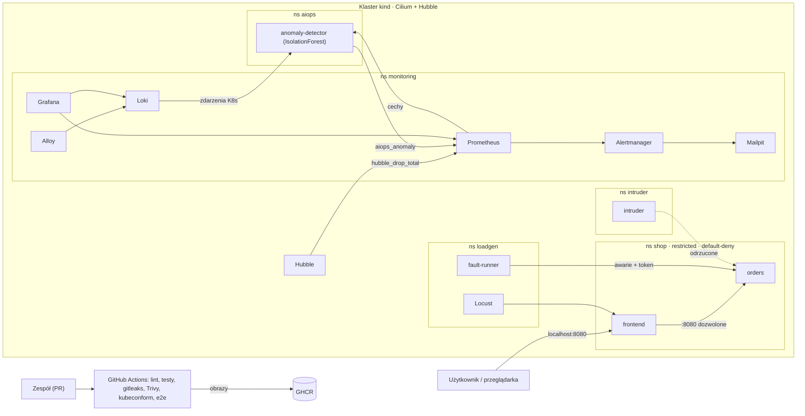

# Karta zgłoszenia projektu

## Zespół

Nazwa zespołu: _do uzupełnienia_

| Rola | Osoba | Odpowiada za |
|---|---|---|
| R1 Platforma i lider techniczny | _do uzupełnienia_ | klaster kind z Cilium, powtarzalne wdrożenie, CI/CD i obrazy, logi, overlay chmurowy, IaC; prowadzi sprinty |
| R2 Bezpieczeństwo | _do uzupełnienia_ | model zagrożeń, RBAC, NetworkPolicy, Pod Security, sekrety, CI, testy bezpieczeństwa, raport testów |
| R3 Obserwowalność (SRE) | _do uzupełnienia_ | usługi demonstracyjne, Prometheus, alerty, Grafana, generator ruchu, dokumentacja i demo |
| R4 AI/ML | _do uzupełnienia_ | awarie i scenariusze, dane i cechy, model detekcji, serwis detektora, ewaluacja |

## Temat

Nr _do uzupełnienia_ — Bezpieczna platforma Kubernetes z obserwowalnością AI

## Problem biznesowy

Firma uruchamia mikroserwisy w Kubernetes. W projekcie jest to sklep internetowy z publiczną usługą `frontend` i wewnętrznym API zamówień `orders`. Firma ma trzy problemy:

1. Przejęcie jednej usługi nie może dawać dostępu do pozostałych usług, sekretów ani API klastra.
2. Obrazy z podatnościami i sekrety w repozytorium nie mogą trafić do wdrożenia.
3. Awarie, przeciążenia i podejrzany ruch trzeba wykrywać wcześnie, bez ręcznego strojenia progów dla każdej metryki.

Projekt dostarcza demonstracyjną platformę, która rozwiązuje te problemy na lokalnym klastrze i daje się odtworzyć jedną komendą.

## Zakres MVP

- Lokalny klaster kind (3 węzły) z CNI Cilium i Hubble, stawiany przez `make up` z przypiętymi wersjami.
- Dwie usługi: `frontend` (publiczna) i `orders` (wewnętrzne API zamówień chronione tokenem).
- RBAC: konta usług bez tokenów API; role zespołu „developer” i „sre” bez dostępu do sekretów.
- NetworkPolicy default-deny z jawnie dozwolonymi przepływami; pod `intruder` do testu niedozwolonego połączenia.
- Pod Security Admission `restricted`: kontenery bez roota, system plików tylko do odczytu, bez dodatkowych uprawnień.
- Sekrety generowane przy wdrożeniu, nigdy w repozytorium; gitleaks w pre-commit i CI.
- Skan obrazów i manifestów Trivy w CI, który blokuje podatności CRITICAL/HIGH z dostępną poprawką.
- Metryki (Prometheus), logi i zdarzenia Kubernetes (Loki + Alloy), dashboardy Grafana.
- Alerty Alertmanager → Mailpit: regułowe, bezpieczeństwa (odrzucone połączenia), ML i hybrydowy.
- Detekcja anomalii w metrykach kontenerów (IsolationForest) ze scenariuszami awarii i ewaluacją.
- Testy automatyczne (pytest) i raport testów z mapą kryteriów odbioru.

## Kryteria odbioru → dowód

| Kryterium | Dowód |
|---|---|
| Powtarzalny manifest | `make down && make up` od zera na dwóch maszynach + zielony e2e w CI (T04, T28) |
| Odmowa połączenia | test `intruder → orders` i przepływ `DROPPED (POLICY_DENIED)` w Hubble (T12, T26) |
| Obserwowalność | dashboardy Platforma, Bezpieczeństwo i AIOps; logi i zdarzenia w Loki (T16, T17, T22) |
| Alert | e-maile `PolicyDeniedConnections`, `AnomalyDetected` i `IncidentConfirmed` w Mailpit (T19, T24, T25, T27) |
| Raport testów | `docs/raport-testow.md`: wyniki testów, skany Trivy, ewaluacja detekcji (T31) |

## Wstępny diagram

## Plan źródeł danych

| Źródło | Co daje | Zbieranie | Gdzie | Użycie |
|---|---|---|---|---|
| kubelet / cAdvisor | CPU, pamięć, sieć kontenerów | Prometheus | Prometheus | dashboardy, alerty regułowe, cechy ML |
| kube-state-metrics | restarty, gotowość, limity zasobów | Prometheus | Prometheus | dashboardy, alerty, cechy ML |
| Metryki aplikacji | żądania, błędy 5xx, czasy odpowiedzi | ServiceMonitor | Prometheus | dashboardy, alerty, cechy ML |
| Hubble (Cilium) | przepływy i odrzucenia z powodem (`POLICY_DENIED`) | ServiceMonitor Cilium | Prometheus; przepływy na żywo w Hubble UI | alert bezpieczeństwa, cecha ML, demo |
| Logi kontenerów (JSON) | zdarzenia aplikacji i błędy | Grafana Alloy | Loki | analiza incydentów, dashboardy |
| Zdarzenia Kubernetes | BackOff, OOMKilled, Unhealthy itd. | Alloy (`loki.source.kubernetes_events`) | Loki | kontekst alertu ML (analiza zdarzeń), dashboardy |
| Detektor anomalii | wynik, próg, flaga anomalii | ServiceMonitor | Prometheus | dashboard AIOps, alerty ML i hybrydowy |
| Orkiestrator scenariuszy | okna awarii (etykiety prawdy) | `chaos/run.py` | `reports/runs/<id>/labels.jsonl` | ewaluacja detekcji |
| CI | wyniki testów, skany Trivy | GitHub Actions | artefakty, GitHub code scanning | raport testów |

Wszystkie dane są syntetyczne (generator ruchu i scenariusze awarii). Projekt nie przetwarza danych osobowych.

## Technologie

| Obszar | Wybór | Dlaczego |
|---|---|---|
| Klaster | kind 0.33 (Kubernetes 1.37), 3 węzły | działa lokalnie i w CI, konfiguracja w jednym pliku |
| CNI | Cilium 1.20 + Hubble | egzekwuje NetworkPolicy i raportuje odrzucenia jako metryki (Calico OSS tego nie ma) |
| Wdrożenie | Makefile, Helm 4, Kustomize, mise | jedna komenda, wersje przypięte w repozytorium |
| Usługi | Python 3.13, FastAPI | ten sam język co ML |
| Metryki i alerty | kube-prometheus-stack | Prometheus, Alertmanager i Grafana w jednym chartcie |
| Logi | Loki + Grafana Alloy | Promtail ma EOL od 2 marca 2026 |
| Powiadomienia | Mailpit | lokalna skrzynka; alert widoczny bez kont zewnętrznych |
| Bezpieczeństwo | RBAC, Pod Security Admission, NetworkPolicy, Trivy, gitleaks | wymogi MVP; tylko standardowe API Kubernetes |
| ML | scikit-learn (IsolationForest), pandas | uczenie bez etykiet na małych danych, szybkie |
| Ruch i awarie | Locust, własny fault-runner | powtarzalny ruch i scenariusze z etykietami |
| Testy | pytest, pytest-html | jeden format wyników do raportu |
| CI/CD | GitHub Actions, GHCR | publiczne repozytorium: 4 vCPU / 16 GB RAM na test e2e |
| Rozszerzenia | OpenTofu, Pushgateway | IaC, dashboard jakości detekcji |

## Hybrydowość

1. **Detekcja hybrydowa (MVP).** Reguły progowe (PrometheusRule) i model ML działają równolegle na tych samych cechach. Alert z reguły albo z ML to ostrzeżenie. Gdy oba zadziałają dla tej samej usługi, powstaje alert krytyczny `IncidentConfirmed`. Raport porównuje reguły, ML i ich połączenie.
2. **Infrastruktura hybrydowa.** Manifesty używają tylko standardowych API Kubernetes (NetworkPolicy v1, Pod Security Admission, RBAC), więc działają poza kind. W MVP są dwa overlaye Kustomize, oba walidowane w CI: `local` (kind) i `cloud` (zarządzany Kubernetes, obrazy z GHCR, LoadBalancer). Rzeczywiste wdrożenie w chmurze przez OpenTofu to rozszerzenie (T33).

## Ryzyka

| # | Ryzyko | Ograniczenie |
|---|---|---|
| 1 | Stos (Cilium, Prometheus, Loki, Grafana) nie mieści się albo nie działa na laptopach zespołu (różne systemy, mało RAM) | wersje przypięte w `mise.toml` i `versions.env`; `make doctor`; zasoby dobrane pod laptop; wzorcowym środowiskiem jest e2e w CI (4 vCPU / 16 GB); demo na najmocniejszej maszynie |
| 2 | Model ML daje dużo fałszywych alarmów albo gubi awarie (mało danych, brak etykiet) | scenariusze awarii z etykietami; kalibracja progu na danych bazowych; porównanie z regułami; alerty regułowe działają niezależnie od ML; uczciwe miary w raporcie |
| 3 | Wyciek sekretu w publicznym repozytorium albo atak na łańcuch dostaw (podatne obrazy, przejęte akcje CI, jak kompromitacja Trivy z marca 2026) | sekrety generowane przy wdrożeniu; gitleaks w pre-commit i CI; akcje przypięte po SHA; przypięta wersja Trivy; Dependabot; ochrona gałęzi `main` |

## Plan sprintów

| Sprint | Tygodnie | Cel (demo na koniec sprintu) | Zadania |
|---|---|---|---|
| 1 Fundament | 1–2 | `make up` stawia kind z Cilium/Hubble i obie usługi; CI blokuje sekrety; karta złożona | T01–T09 |
| 2 Bezpieczeństwo i obserwowalność | 3–4 | test niedozwolonego połączenia przechodzi i kończy się e-mailem w Mailpit; metryki i logi w Grafanie; obrazy skanowane w CI | T10–T21 |
| 3 Detekcja AI i alerty | 5–6 | wstrzyknięta awaria daje alert ML i hybrydowy; dashboardy; zielony e2e w CI | T22–T29 |
| 4 Raport, demo, rozszerzenia | 7–8 | raport testów z mapą kryteriów, ewaluacja detekcji, próba generalna demo; rozszerzenia | T30–T36 |

Sprint 1:

| Zadanie | Rola |
|---|---|
| T01 Karta zgłoszenia i organizacja zespołu | R1 (wszyscy) |
| T02 Środowisko deweloperskie | R1 |
| T03 Klaster kind z Cilium i Hubble | R1 |
| T04 Powtarzalne wdrożenie | R1 |
| T05 Usługi frontend i orders | R3 |
| T06 CI: lint, testy, gitleaks, walidacja manifestów | R2 |
| T07 Model zagrożeń | R2 |
| T08 Wstrzykiwanie awarii i fault-runner | R4 |
| T09 Prototyp detektora na danych syntetycznych | R4 |

Definicja ukończenia zadania:
- kod w PR z `Closes #N`, jedna recenzja, CI zielone;
- po zmianach platformy `make down && make up` dalej działa;
- kryteria akceptacji w issue odhaczone, dowód (log, zrzut ekranu) w komentarzu;
- zmiana kontraktu zaktualizowana w `docs/architektura.md`.

## Repozytorium

https://github.com/l3x1cn/secure-k8s-aiops. Zadania są w Issues, sprinty w Milestones, tablica w GitHub Projects.
